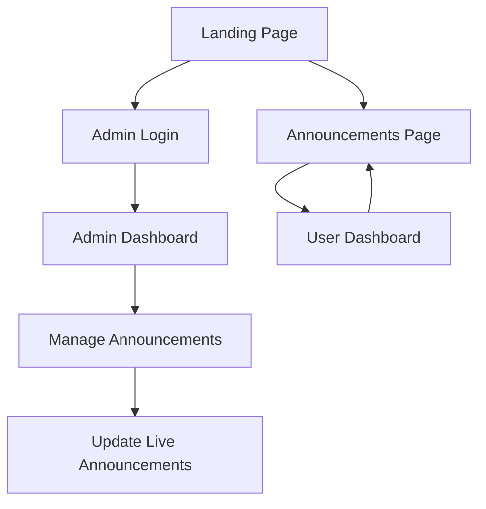

# ReSearchathon 2025 Official Platform

Researchathon 2025 is the official announcement and management platform for the Researchathon 2025 event at RVCE. This web portal provides live updates, secure admin access, and a smooth experience for both organizers and participants.

---

## Project Architecture


```
```
## Features
- Official platform for live Researchthon 2025 updates
- Distinct dashboards for Admin and Participants
- Admins can securely login and update announcements in real-time
- Announcement management (add, edit, delete with previews)
- Responsive and fast: Vite + React with Tailwind CSS
- Firebase hosting and announcements integration
- Modular folder structure for scalable development

## Folder Structure
```
Researchthon-2025/
├── src/
│   ├── pages/            # Fullscreen pages for routing
│   ├── components/       # Reusable components
│   ├── layout/           # Navbar and Footer layout logic
│   ├── firebase/         # Firebase config, queries and helpers
│   ├── utils/            # Utility JS helpers (formatting, auth, etc)
│   ├── App.jsx           # Global app router
│   └── main.jsx, index.css
├── public/               # Static assets (logo, favicon)
├── firebase.json, .firebaserc
├── package.json, vite.config.js, tailwind.config.js
```
```
```
## Usage
1. Install dependencies:
   ```bash
   npm install
   ```
2. Start the development server:
   ```bash
   npm run dev
   ```
3. Build for production:
   ```bash
   npm run build
   ```
4. Deploy using Firebase CLI:
   ```bash
   firebase deploy
   ```

## Dashboards

### Admin Dashboard
- Secure login for organizers
- Add, edit, or delete announcements
- Manage files and monitor activity
- Updates push instantly for all users

### User Dashboard
- Browse official announcements
- Live updates—see new information in real-time
- Access event resources and help

---

## Development & Contribution
- Extend pages/components as needed
- All announcement update logic lives in `src/firebase/queries.js`
- Style and animation code can be added to the appropriate layout/component/page file
- PRs and issues welcome for contributions & bug reports

## License
MIT
